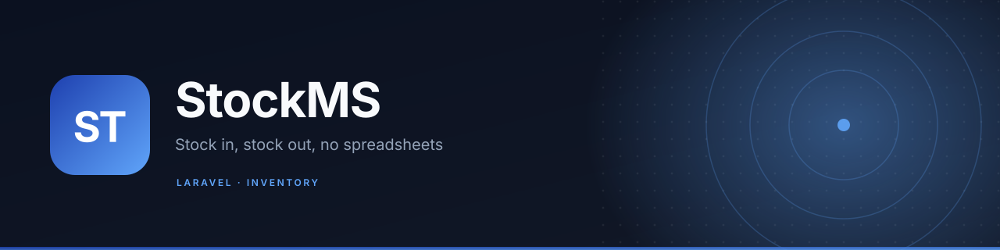

<p align="center">
  
</p>

<p align="center">
  
  
  
  
</p>

**A stock management system for a small store.** Products, stock-in and stock-out movements, and the reports that tell you what is actually moving — without a spreadsheet that nobody updates.

## Features

- **Authentication** — registration, login, logout with Laravel's session guard.
- **Product catalogue** — create, edit and delete products with price and quantity.
- **Stock in** — receive stock against a product, with supplier and date.
- **Stock out** — issue stock, with reason and date.
- **Movement history** — every in/out entry is retained for audit.
- **Reports** — stock levels and movement summaries for a chosen period.
- **Validation and foreign keys** — server-side rules on every form; deletes cascade predictably.

## Modules

| Route | Purpose |
| --- | --- |
| `/` | Login |
| `/register` | Create an account |
| `/dashboard` | Summary counts and recent movement |
| `/products` | Product CRUD |
| `/stockin` | Record incoming stock |
| `/stockout` | Record outgoing stock |
| `/reports` | Stock and movement reports |

## Tech stack

Laravel 11 · PHP 8.2 · Blade · MySQL (SQLite for local development) · Vite · Tailwind CSS

## Getting started

```bash
composer install
cp .env.example .env
php artisan key:generate

# SQLite is the fastest path
touch database/database.sqlite
# set DB_CONNECTION=sqlite in .env

php artisan migrate
npm install && npm run build
php artisan serve
```

Open <http://127.0.0.1:8000> and register an account.

For MySQL, create the database and set `DB_CONNECTION=mysql`, `DB_HOST`, `DB_PORT`, `DB_DATABASE`, `DB_USERNAME` and `DB_PASSWORD` before migrating.

## Project structure

```
app/Http/Controllers/   Auth, Product, Stockin, Stockout, Report
app/Models/             product, stockin, stockout, report, User
database/migrations/    products, stock movements, users
resources/views/        Blade screens and layout
routes/web.php          Web routes
```

## Status

Working academic project (2025). Single-role access: every signed-in user can manage stock. The original README was the Laravel skeleton; this one replaces it.

## Author

**Bikorimana Ange Tresor** — [@tres9lo](https://github.com/tres9lo)

## License

[MIT](LICENSE)
